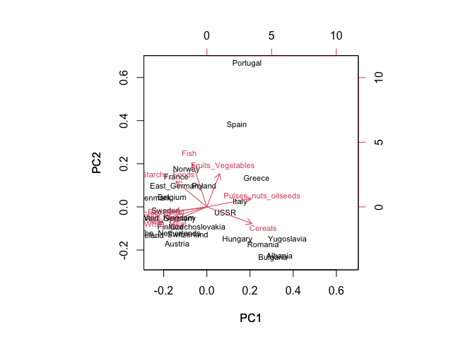
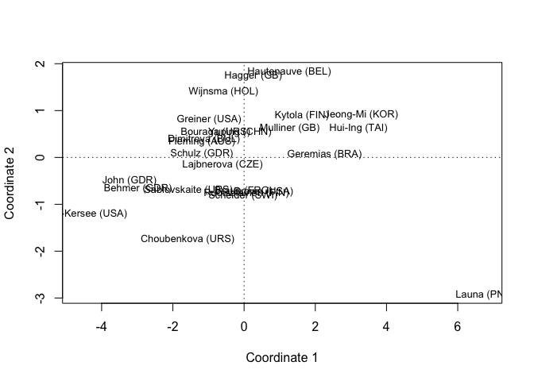
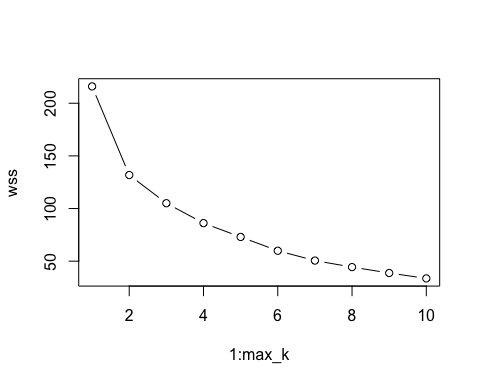
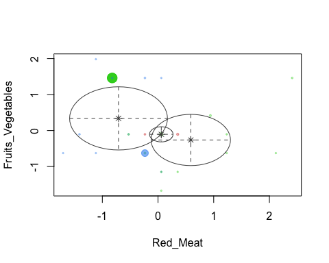

# Applied Statistics & Multivariate Analysis in R

**R · R Markdown · HSAUR2 · MASS · mclust · arules** · Texas Tech University, M.S. Data Science
ISQS 5346 (Summer 2025) · ISQS 6350 Multivariate Methods (Fall 2025)

## Overview
Two graduate statistics courses worth of analysis in R Markdown, each with code, output and a written interpretation. The first course builds the foundation (descriptive statistics, probability, distributions, confidence intervals and hypothesis tests on real datasets); the second moves to multivariate methods (principal components, multidimensional scaling, factor analysis, clustering and association rules).

## What's inside
| Assignment | Data | Methods | Notebook · Report |
|---|---|---|---|
| ISQS 5346 HW1 | Men's track records by country; graduate exit survey | Summary statistics, z-scores and outliers, correlation matrix, contingency and proportion tables, conditional probability | [Rmd](notebooks/ISQS5346_HW1_descriptive_stats_probability.Rmd) · [docx](reports/ISQS5346_HW1_descriptive_stats_probability.docx) |
| ISQS 5346 HW2 | Clinical cure rates; library patron counts | Binomial and Poisson distributions, exact probabilities, 10,000-trial simulation | [Rmd](notebooks/ISQS5346_HW2_binomial_poisson_distributions.Rmd) · [docx](reports/ISQS5346_HW2_binomial_poisson_distributions.docx) |
| ISQS 5346 HW3 | Insurance claims; public vs. private comparison; exit survey | Confidence intervals for a proportion and a mean, two-sample t-test, chi-square test of independence | [Rmd](notebooks/ISQS5346_HW3_confidence_intervals_hypothesis_tests.Rmd) · [docx](reports/ISQS5346_HW3_confidence_intervals_hypothesis_tests.docx) |
| ISQS 6350 HW2 | Skulls, European protein consumption, 1988 Olympic heptathlon | PCA on the correlation matrix, loadings, biplots, distance matrices, classical multidimensional scaling | [Rmd](notebooks/ISQS6350_HW2_PCA_biplot_MDS.Rmd) · [docx](reports/ISQS6350_HW2_PCA_biplot_MDS.docx) |
| ISQS 6350 HW3 | School-subject correlations, gene expression (healthy vs. diseased), protein data, course-topic transactions | Exploratory factor analysis (2 vs. 3 factors, rotated vs. unrotated), hierarchical clustering (average, complete, single linkage), k-means with an elbow plot, model-based clustering (mclust), association rules (arules) | [Rmd](notebooks/ISQS6350_HW3_factor_analysis_clustering_association_rules.Rmd) · [docx](reports/ISQS6350_HW3_factor_analysis_clustering_association_rules.docx) |

## Selected results (from the reports)
- **Binomial model of a treatment (n = 75, p = 0.45):** expected 33.75 cured patients, SD ≈ 4.31; about a **4% chance** the cure rate looks like 30% or lower even when it's truly 45%. A 10,000-trial simulation reproduces the distribution.
- **Poisson model of library patrons (λ = 600):** mean 600, SD ≈ 24.49, with grouped probabilities by range.
- **Insurance claims:** a 95% CI showed the company's 75% estimate of claims with exaggerated loss is likely **too high**, while its $400 average excess-payment estimate falls **inside** the CI.
- **Public vs. private:** two-sample t-test with p < 0.05, so the null hypothesis of equal means is rejected.
- **European protein PCA:** the first two principal components explain **63.6%** of total variance; a biplot and standardized z-scores for two countries confirm the interpretation.
- **Heptathlon:** PC1 lines up almost perfectly with the official 1988 Olympic score; MDS maps athletes and events in two dimensions.

## Charts
| Protein consumption PCA biplot | Heptathlon athletes, 2-D MDS |
|---|---|
|  |  |
| **k-means elbow plot (protein data)** | **Model-based clustering (mclust)** |
|  |  |

All exported charts (distributions, simulations, dendrograms, biplots) are in [`images/`](images).

## Repo structure
```
notebooks/  R Markdown source for each assignment
reports/    knitted Word reports with code, output and interpretation
images/     charts exported from the reports
```
Data is read straight from the course's public GitHub data repository inside each notebook (no local data files needed).

## How to run
Open any `.Rmd` in RStudio and click **Knit** (install `HSAUR2`, `MASS`, `mclust` and `arules` first where used).

## Skills demonstrated
Descriptive statistics · probability and distributions · simulation · confidence intervals · hypothesis testing · PCA · multidimensional scaling · factor analysis · hierarchical, k-means and model-based clustering · association rules · reproducible reporting with R Markdown

---
**Jada Malone** · Data Analyst · M.S. Data Science, Texas Tech University · [GitHub profile](https://github.com/jada-malone) · [LinkedIn](https://www.linkedin.com/in/jada-malone-509170280)
